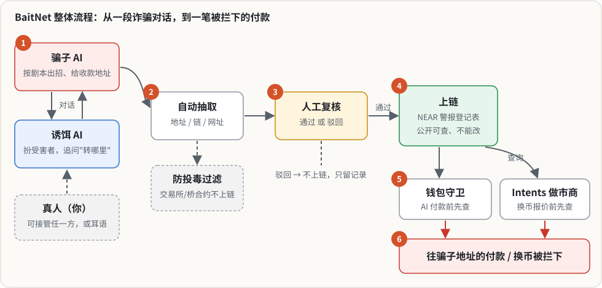

# BaitNet

[中文版 README](README.zh-CN.md)

BaitNet uses AI decoys that pose as scam victims to get scammers to reveal their payment addresses. A human reviews each extracted address before it goes on chain. Approved addresses are written to an alert registry contract on NEAR. AI payment agents and NEAR Intents market makers check that registry before they move money, so a payment to a flagged address is refused before it is sent.

Built at NEAR HACKATHON 2026 (tracks: 06 AI Security & Defense, 03 Privacy & Private AI).

- Hosted demo (read-only snapshot): `<TBD>`
- Testnet contracts: `registry.baitnet-651f.testnet`, `vault.baitnet-651f.testnet` (see [Testnet deployment](#testnet-deployment))
- Demo video: `<TBD>`

## The problem

- Crypto scams are the largest category of reported online-fraud losses. In 2024, the FBI's IC3 received 149,686 complaints involving cryptocurrency, with **$9.3 billion** in reported losses. Cryptocurrency investment fraud alone accounted for 41,557 complaints and **$5.8 billion**. The IC3 total for all categories was $16.6 billion. Source: [FBI IC3 2024 Internet Crime Report](https://www.ic3.gov/AnnualReport/Reports/2024_IC3Report.pdf).
- Victims usually report after the money has already moved. Existing intelligence-sharing networks mostly reach centralized exchanges and stablecoin issuers. Bridges, DEXs, wallet apps, intent solvers and, more and more, **AI agents that hold funds** have no common place to check "is this a known scam address?" before they pay.
- Collecting a scam address today usually means a real victim has already paid into it. Scam-baiting with AI decoys (for example [Apate.ai](https://techcrunch.com/2026/10/14/apate-sends-ai-agents-undercover-to-get-scammed-so-they-can-gather-fraud-intelligence/), which reports bank mule accounts to banks and telcos) can surface these accounts first. Nobody has built the on-chain version for crypto addresses that any wallet or agent can query.
- Users' personal data cannot simply be pooled and shared between companies (GDPR, China's PIPL and similar laws). A scam address, by contrast, is already public information.

BaitNet publishes **only the scam address plus a hash of the evidence**. Each wallet, exchange or agent checks addresses against its own local copy of the registry. It never sends its users' data anywhere.

## Demo walkthrough

Run `pnpm demo` (see [Quick start](#quick-start)), then open http://localhost:5173. The top navigation is numbered in demo order, and every page has a "Next" button.

| Do | See |
|---|---|
| Watch the `pnpm demo` terminal log | A local NEAR sandbox starts. `registry.test.near` and `vault.test.near` are deployed. The `agent` account is created with **one function-call key only** (receiver `vault.test.near`, method `pay`). Storyline ①–⑥ below runs automatically. |
| **0 Arena** → pick a script (e.g. `investment-01`) → Start → Run | A scammer AI (playing from one of 34 scripts) and a decoy AI talk. When the scammer gives a payment address, it appears in the right-hand panel as a draft. |
| In Arena, switch either side to **Take over** or **Whisper** | Take over: you type that side's lines and the AI stops. Whisper: the AI keeps talking but reads your private hint. Both can be changed at any time. |
| Click **Approve** on the extracted address | The address is written to the registry contract and a transaction hash is shown. Poisoned addresses (exchange hot wallets, bridge contracts) are marked "filtered" and are not sent on chain. |
| **1 Decoy** → play a recorded conversation | A decoy gets a fake-support scammer to give a NEAR account and a BTC address. Both are already on chain. |
| **2 Registry** → click an alert | Address, chain, level (L1/L2), status, the reporting transaction and the evidence hash. The browser recomputes the hash locally and shows "evidence unchanged". |
| **3 Guard** | ③ Prompt-injection attack: an accounts-payable agent reads a task with a hidden HTML block that tells it to send 50 NEAR to `goldbridge-desk.near`, an address already flagged in the registry (`fixtures/tasks/injected-payment.txt`). The guard returns **block**, the wallet refuses to sign, and the same payment sent directly to `vault.pay` **fails on chain**. ④ An Intents 1Click swap request whose `recipient` / `refundTo` is a flagged address: the market maker **refuses to quote**. Each entry shows the signals and the full log. |
| **4 Fund flow** | ⑤ Earlier funds from a flagged NEAR account, traced through NEAR Intents to Tron, Ethereum and Bitcoin addresses (sample data, see limitations). |
| **5 Response** | ⑥ Which voluntarily registered responders (demo wallet, demo exchange) acknowledged each alert, when, and what they did. |
| **6 TEE** | A NEAR AI Cloud attestation report checked item by item (nonce binding, Intel TDX quote, event-log replay, GPU evidence). Offline it shows a recorded sample, labelled as such. |
| **7 Training** → turn on training mode in Arena, rate a decoy line, rewrite it, approve it | The rewrite enters the playbook (version +1) and becomes a regression case. The decoy retrieves playbook examples by scam type, stage and tags. |
| `pnpm eval` → **8 Report card** | All 34 scripts run end to end. Results are split into Chinese and English scripts: address extracted, turns, leaks, hijacks, poison filtered, on chain. |
| `pnpm demo --ci` | Headless check of the core flow. It ends with `✓ 全部通过` ("all passed") and exit code 0. |

The user manual (Chinese, with screenshots) is in [docs/manual/使用说明书.md](docs/manual/使用说明书.md).

## Quick start

No API keys, no NEAR account and no Rust are needed. The default demo runs a **local NEAR sandbox** chain, deploys the **prebuilt contracts** committed in `contracts/*/res/`, and replays recorded LLM conversations.

### Requirements

| | Needed for | Notes |
|---|---|---|
| **Node.js ≥ 22.22** | everything | `node -v` (exactly: `>=22.22.2`, required by `near-api-js` 7 and `near-sandbox`) |
| **pnpm 10** | everything | `corepack enable` (uses the version pinned in `package.json`), or `npm i -g pnpm@10` |
| OS: **Linux x86_64 / aarch64** or **macOS Apple Silicon** | local sandbox | the prebuilt `near-sandbox` binary only exists for these platforms. Intel Macs / Windows: use WSL2 or Linux (or the in-memory fallback below). The macOS build links Homebrew's `liblzma`; the demo points it at the system copy automatically, no `brew install` needed. |
| Internet on first run | downloads | npm packages + the sandbox binary (~30 MB, once, cached in `.cache/near-sandbox/`, resumable with retries) |
| Rust + `cargo-near` | **only** if you change `contracts/` | see [Contracts](#contracts) |

Ports used: `3030` (sandbox RPC, falls back to a random port if busy), `8787` (backend API), `5173` (dashboard).

### Run it

| Do | See |
|---|---|
| `pnpm install` | dependencies installed (≈1 min) |
| `pnpm demo` | step log: sandbox started → `registry.test.near` and `vault.test.near` deployed → accounts `owner` / `reporter` / `agent` / 2 responders created → the agent gets **only** a function-call key limited to `vault.test.near` / `pay` → storyline ①–⑥ runs (`pnpm --filter @baitnet/agent run demo -- --replay`) → server and web start. It ends with **`➜ 打开 http://localhost:5173`** |
| open http://localhost:5173 (use **`localhost`**, not `127.0.0.1` — the Vite dev server may listen on IPv6 `::1` only) | the dashboard: alert list, evidence detail, guard log (the prompt-injected payment **blocked**), fund-flow graph, responder table |
| `Ctrl-C` (or `kill -TERM` / `kill -HUP`) | server, web and the sandbox are all shut down; ports 3030 / 8787 / 5173 are released. Even if the demo is killed with `-9`, a small watchdog cleans up, and the next `pnpm demo` kills anything left over (recorded in `data/.demo-pids.json`). |
| `pnpm demo --ci` | headless smoke run (backend P0 flow `demo-flow`), no long-running services. Checks: alerts are on chain, `registry.check()` hits the reported address, `vault.pay` to the flagged address is **rejected on chain** while a clean payment succeeds, the agent key cannot transfer NEAR directly, and `GET /alerts` answers. Ends with `✓ 全部通过` and exit code 0 (or the list of failures and exit code 1). `pnpm demo --ci --full` runs the full storyline ①–⑥ with the same checks. |

`make demo` and `make demo-ci` do the same (`make help` lists everything). `make test` = `pnpm test` **plus** the Rust contract tests when `cargo` is installed (slower; downloads the sandbox for near-workspaces once).

The local chain is rebuilt on every run; your training data in `data/` is **kept** (see [Local data](#local-data-what-is-kept-backups-reset)). If port 3030 is taken the sandbox uses a random free port (written to `data/runtime.json`). If port 5173 is already serving, the demo does not start a second web server and tells you so.

**Fallback.** If the sandbox binary cannot be downloaded or started, `pnpm demo` prints a warning and continues with the backend's in-memory registry: storyline, guard blocks and dashboard still work, but nothing is written to a chain and the on-chain vault check is skipped; the output says **内存模式** clearly. Unrecoverable download errors (DNS failure, connection refused, HTTP 4xx) fall back immediately; other errors are retried (resuming the download) for about 20 s without progress. To skip the chain on purpose: `BAITNET_REGISTRY=memory pnpm demo`.

`pnpm demo --ci` does **not** fall back: without a chain it exits 1 (`BAITNET_REQUIRE_CHAIN=0` allows the fallback; the result is then reported as "链下部分通过 — 内存模式", never as a full pass). `BAITNET_REQUIRE_CHAIN=1` forbids the fallback in every mode.

The first `pnpm demo` downloads the sandbox binary; to do that ahead of time (or to check your network) run `pnpm sandbox:fetch`. If the download host is blocked, set `SANDBOX_ARTIFACT_URL` to a mirror or `NEAR_SANDBOX_BIN_PATH` to an existing `near-sandbox` binary.

### Other modes

| Command | What it uses | Needs |
|---|---|---|
| `pnpm demo` (= `offline`) | local sandbox, replayed LLM, fixtures | nothing |
| `pnpm demo testnet` | contracts already deployed on NEAR testnet | `.env` with the testnet contract ids and account keys (see `.env.example`). Does not create accounts or deploy. |
| `pnpm demo live` | testnet (or sandbox if not configured) + real NEAR AI Cloud / Claude / Intents dry-run quotes | any of `NEARAI_API_KEY`, `ANTHROPIC_API_KEY`, `INTENTS_EXPLORER_JWT`, `LIVE_INTENTS=1`. Missing keys fall back to replay/fixtures. |
| `pnpm demo:export` | offline flow, then writes `apps/web/public/snapshot.json` and builds `apps/web/dist` | nothing; the output is a static site (`vercel.json` included). `snapshot.json` is **committed on purpose**: it is the data the hosted demo serves, so re-running export changes it (new timestamps / tx hashes) — commit it when you want the hosted demo updated. It never contains keys (export refuses if it finds one). |

`cp .env.example .env` — every variable is documented there, including what happens when it is missing.

### Local data: what is kept, backups, reset

Everything lives in `data/` (git-ignored). Because the local sandbox chain is **rebuilt on every `pnpm demo`**, only state bound to the previous chain is cleared on start; expert work is kept.

| Cleared on every start (sandbox / memory mode) | Kept |
|---|---|
| `runtime.json` (RPC URL + throw-away sandbox keys), `memory-registry.json`, `reports.json`, `events.jsonl`, `flows.json`, `ack-receipts.json`, `review-log.jsonl`, `code-hashes.json` — they reference alert ids, tx hashes and accounts of the old chain and are regenerated by the demo flow | `training.sqlite` (+ `-wal`/`-shm`: corrections, playbook, annotations), `arena/sessions/`, `evidence/` (encrypted originals + `evidence/.key`), `eval/`, `training-export/`, `conversations/`, `backups/` |

In `testnet` mode nothing is cleared (that chain persists).

- **Backups.** Every start copies `data/training.sqlite` (WAL included, via `VACUUM INTO`) to `data/backups/training-<timestamp>.sqlite`; the newest 10 are kept (`BAITNET_BACKUPS_KEEP`). Restore: stop the demo, then `cp data/backups/training-<timestamp>.sqlite data/training.sqlite && rm -f data/training.sqlite-wal data/training.sqlite-shm`.
- **Full reset.** `pnpm demo --fresh` (or `pnpm demo:fresh`) backs up first, prints exactly what will be deleted, waits 5 s (Ctrl-C cancels), then wipes all of `data/` except `evidence/.key` and `backups/`.
- **Old arena sessions after a restart.** Sessions in `data/arena/sessions/` keep their conversations, annotations and drafts, but a draft's `alertId` / `txHash` points at the *previous* chain and is no longer valid on the new one (alert ids restart from 0). Treat them as history; re-submit a draft to get a new on-chain alert.

## Contracts

Prebuilt wasm is committed: `contracts/registry/res/registry.wasm`, `contracts/vault/res/vault.wasm`. Only needed when changing contracts:

```bash
curl --proto '=https' --tlsv1.2 -sSf https://sh.rustup.rs | sh   # Rust
cargo install --locked cargo-near
pnpm contracts:build     # rebuild res/*.wasm
pnpm contracts:test      # cargo test (unit + near-workspaces integration tests)
```

## Development

| Command | |
|---|---|
| `pnpm typecheck` / `pnpm test` / `pnpm build` | all workspace packages |
| `pnpm hooks:install` | installs a git **pre-commit hook** that runs `scripts/check-secrets.sh` on staged files and blocks commits containing NEAR private keys, API keys, JWTs, `.env` files or `data/runtime.json`. False positive: add `secret-scan:allow` on the line. |
| `pnpm check-secrets` | same scan over the whole working tree |
| `pnpm check-ignored` | fails if any source file under `apps/ packages/ contracts/ scripts/` is git-ignored (a clone would miss it) |

CI (`.github/workflows/ci.yml`): typecheck, unit tests, `pnpm demo --ci` and `--ci --full`, `cargo test` for contracts, the ignored-source check, and a gitleaks scan of the full git history.

## Testnet deployment

| Contract / account | Testnet id | Explorer |
|---|---|---|
| Alert registry | `registry.baitnet-651f.testnet` | [nearblocks](https://testnet.nearblocks.io/address/registry.baitnet-651f.testnet) |
| Vault | `vault.baitnet-651f.testnet` | [nearblocks](https://testnet.nearblocks.io/address/vault.baitnet-651f.testnet) |
| Agent (function-call key only) | `agent.baitnet-651f.testnet` | [nearblocks](https://testnet.nearblocks.io/address/agent.baitnet-651f.testnet) |
| Reporter | `reporter.baitnet-651f.testnet` | [nearblocks](https://testnet.nearblocks.io/address/reporter.baitnet-651f.testnet) |

Deployed 2026-11-10 with `contracts/scripts/deploy-testnet.sh`, which also ran an on-chain smoke test: the reporter flagged `baitnet-smoke-scam.testnet`, the agent's `vault.pay` to it failed with `PAY_BLOCKED`, a payment to a clean account went through, and the test alert was revoked. The agent account holds a single function-call key limited to `pay` on the vault (0.25 NEAR allowance); its full-access key was deleted.


`pnpm demo testnet` uses these contracts when the ids and keys are set in `.env`. The default `pnpm demo` does not need them: it deploys the same prebuilt wasm to a local sandbox.

## Architecture



```
 scammer AI (34 scripts) ⇄ decoy AI (+ safety filter, playbook)      ← a human can take over either side or whisper
          │ every scammer line
          ▼
 extraction (NEAR / EVM / Tron / BTC, URLs, phones) ─▶ poison filter ─▶ human review
          │ evidence: redacted record → sha256; full text AES-256-GCM, local only
          ▼
 NEAR contract: AlertRegistry  (address, chain, level, status, evidence hash)
          │ view: check / list_alerts
          ├─▶ guard (packages/guard): allow / warn / block, compared against a local copy
          │      ├─▶ AI wallet: block → refuse to sign, warn → ask a human
          │      └─▶ Intents market maker: block → refuse to quote
          └─▶ Vault contract: pay() calls registry.check() cross-contract, fails if flagged
 fund-flow tracing (Intents Explorer data) ─▶ L2 alerts;  responder acks ─▶ dashboard
```

| Module | Path | What it does |
|---|---|---|
| Alert registry contract | `contracts/registry` | Reporters write alerts; status Active / Disputed / Revoked; responders register and ack; public `check` / `list_alerts` views |
| Vault contract | `contracts/vault` | The agent can only pay through `pay()`. It enforces per-transaction and daily limits and checks the registry before transferring. |
| Guard | `packages/guard` | Five signals: registry L1, registry L2/disputed, young account, contract code changed recently, no prior interaction. Returns allow / warn / block with reasons. |
| Extraction & evidence | `apps/agent` | Address extraction (including addresses split across messages or written out colloquially in Chinese), poison filter, encrypted evidence, payment agent, Intents solver, fund-flow tracing |
| Arena | `packages/arena` | Scammer vs. decoy sessions, take-over / whisper, rules engine or LLM, decoy safety filter |
| Training | `packages/training` | Ratings, rewrites, review, playbook (tag retrieval), regression cases, export of decoy-side data |
| Script upload | `packages/scriptlab` | Imports txt/md, JSON, Telegram and WhatsApp exports; redacts personal data **before** analysis; produces script and address drafts |
| Server | `apps/server` | HTTP API + SSE on port 8787, TEE attestation check |
| Dashboard | `apps/web` | Vite + React; Chinese and English UI; live mode or static snapshot mode |
| Scam scripts | `fixtures/scripts` | 34 original scripts across 10 scam types (24 Chinese, 10 English), 9 of them poison variants ([list](fixtures/scripts/README.md)) |

Test counts per module (about 340 tests in total, all passing) are listed in [docs/02_系统分析.md](docs/02_系统分析.md) §3.

## Where NEAR is used

| NEAR feature | How BaitNet uses it | Code |
|---|---|---|
| **Smart contract (Rust, near-sdk 5.30)** | `AlertRegistry` is the shared blocklist. Only whitelisted reporters can call `report`. Each alert stores address, chain, level, status and evidence hashes. Anyone can call `check(chain, address)` for free (it is a view call). A disputed alert is downgraded from block to warn; a revoked alert no longer blocks. | `contracts/registry` |
| **Function-call access key** | The payment agent's account has **one key only**: a function-call key with receiver `vault.test.near`, method `pay`, allowance 1 NEAR. With this key the agent **cannot** transfer NEAR directly, **cannot** add or delete keys, and **cannot** call any other contract or method. Once the 1 NEAR gas allowance is used up, the key stops working until the owner replaces it. `pnpm demo` reads the key back from chain and asserts this. `pnpm demo --ci` also checks that a direct transfer signed with this key fails. | `scripts/demo.ts`, `scripts/lib/near.ts` |
| **Cross-contract call (Vault)** | `vault.pay(to, amount)` checks: caller is the agent; amount is within the per-transaction and daily limits (10 / 50 NEAR in the demo). It then calls `registry.check` and transfers only in the callback, and only if the address is not an active L1/L2 alert. If the registry call fails, the payment fails too (fail closed). So even a fully compromised agent that skips the off-chain guard cannot pay a flagged account. | `contracts/vault` |
| **NEAR Intents** | (a) A simulated 1Click market maker runs the guard on `recipient` and `refundTo` before quoting and refuses to quote for flagged addresses. (b) Fund-flow tracing follows a flagged address's money through Intents to other chains. It uses the Intents Explorer API format; offline it uses recorded sample data. | `apps/agent/src/solver`, `apps/agent/src/trace` |
| **NEAR AI Cloud (TEE)** | With a key, the scammer and decoy LLMs are called through NEAR AI Cloud's OpenAI-compatible API first (Claude is the fallback). Zero-retention analysis uses only TEE-hosted NEAR AI Cloud models (see [Track 03](#track-03-requirements-one-by-one)). The TEE page fetches `/v1/attestation/report` with a fresh random nonce and checks: nonce binding in report data, Intel TDX quote (DCAP), measurements, event-log replay to RTMR3, compose hash, NVIDIA GPU evidence. | `apps/server/src/attestation.ts`, `packages/scriptlab/src/ephemeral.ts` |

## Track 06 requirements, one by one

| Requirement (from the 06 track prompt) | Where it is met | How to see it |
|---|---|---|
| Agent-side wrapper: refuse to sign on **block**, ask a human on **warn** | `apps/agent/src/wallet/wallet.ts` (block → refused; warn → `asked-human`, which the demo auto-rejects) | **3 Guard** page, source "Agent wallet" |
| Sign with a **function-call key limited to one contract**, and explain its limits in the README | Agent account: single function-call key, receiver `vault`, method `pay` | `pnpm demo` log line `唯一的 key 是 function-call key…` ("the only key is a function-call key"); [Where NEAR is used](#where-near-is-used) |
| **Attack demo**: a prompt-injected agent tries to pay a known bad address, gets blocked, and the log is shown | `fixtures/tasks/injected-payment.txt` → planner extracts the injected payment → guard **block** → wallet refuses; direct `vault.pay` attempt **fails on chain** | **3 Guard** page; `pnpm demo --ci` checks both |
| Suggested signals: account age/activity, contract or code change, prior interaction, **shared blocklist with evidence** | All five guard signals; the registry is the shared blocklist, and every alert carries an evidence hash | **3 Guard** reasons column; **2 Registry** evidence check |

## Track 03 requirements, one by one

BaitNet has two processing modes:

- **Main flow (arena, upload, evidence, training).** Data is **kept**, encrypted, because an on-chain alert needs evidence behind it and the training loop needs rated conversations (see [Privacy design](#privacy-design)).
- **Zero-retention analysis (decision D27).** `POST /scripts/analyze-ephemeral` analyzes an uploaded chat log without writing anything on the BaitNet server. The text is parsed and redacted in memory, and only the redacted text is sent to a TEE-hosted model on NEAR AI Cloud. The result goes back to the browser together with the attestation result for that call. Nothing is written until the user explicitly confirms "save"; saving re-redacts the result and goes through the normal flow. Details: [docs/dev/zero-retention.md](docs/dev/zero-retention.md).

| Requirement (from the 03 track prompt) | Where it is met | Status |
|---|---|---|
| Call NEAR AI Cloud through the OpenAI-compatible API, key in `.env` | `NEARAI_API_KEY`, `NEARAI_BASE_URL`; zero-retention mode uses `/v1/chat/completions` | Implemented; **not yet tested against the real NEAR AI Cloud** (no key yet, only a mocked endpoint in tests). Will be updated once a key is available. |
| Pick a TEE-hosted model from the models endpoint | Model chosen from `/v1/models` entries marked as TEE; `NEARAI_MODEL` is used only if it is TEE-marked | Same as above |
| Fetch an attestation report with a fresh random nonce, verify it, show a "Verified" panel listing every check | `apps/server/src/attestation.ts`; **6 TEE** page; attached to each zero-retention response; reply signature checked via `/v1/signature/<chat_id>` | Verified offline against a **recorded** report (labelled "recorded sample"); live result `<TBD>` |
| The server keeps no data after the response | `packages/scriptlab/src/ephemeral.ts`. Tests in `packages/scriptlab/test/ephemeral.test.ts` snapshot the `data/` directory before and after (path, size, mtime, sha256), assert zero SQLite calls, and assert no 4-character fragment of the input appears in logs, offline and with a mocked NEAR AI Cloud, for Chinese and English samples | Implemented; 12 tests passing (`packages/scriptlab/test/ephemeral.test.ts`) |
| Fictional sample data so judges need no real data | `fixtures/training/samples/` (a Chinese chat log and an English Telegram export, both fictional) and the 34 fictional scripts | Done |

**Trust boundary (what this does and does not prove):**

- The original text exists **once in BaitNet server memory**, because redaction runs on the server. "Not kept" means: not written to disk, database or logs (covered by tests). Core dumps and OS swap are not covered; disable them in production.
- The **NEAR AI Cloud gateway** sees the redacted text and the model's reply (scam addresses and URLs are intelligence and are not redacted), plus the API key, source IP, time and size. TLS terminates at the gateway, so "the gateway keeps nothing" rests on the gateway's own attestation and NEAR AI's statement; BaitNet cannot prove it independently.
- The attestation proves that this report was produced for this call (nonce bound into the TDX quote), that the quote and GPU evidence verify (Intel DCAP, NVIDIA NRAS), and which image and configuration ran (event-log replay to RTMR3, compose hash). The reply signature (`sha256(request):sha256(response)`) must recover to the model's attested signing address.
- It does **not** prove: that a reply came from the exact instance that produced the report (all instances of a model share the signing key); that the gateway or model deletes data afterwards; or that the BaitNet server keeps nothing (that rests on the open code and the tests above). A **recorded** attestation only demonstrates the flow and proves nothing about a given analysis.
- Screenshots are refused in this mode (image analysis would need Claude, which does not run in a TEE). Without a NEAR AI key the analysis runs in the local rules engine in memory, and the response says it used a recorded attestation. It never falls back to Claude.

## How this differs from HAPI Protocol

[HAPI Protocol](https://hapi-one.gitbook.io/hapi-protocol/) already runs an on-chain risk-address database on NEAR. Whitelisted reporters submit addresses with risk scores, and wallets such as MyNearWallet have integrated it. BaitNet is complementary, not a replacement:

1. **Source of intelligence.** BaitNet's addresses come from AI decoys that talk to scammers. Each address is first-hand (L1) and comes with an evidence hash. Reporters do not submit addresses by hand.
2. **Local comparison.** Subscribers check addresses against a local copy of the registry. Queried addresses and user data are never sent to us.
3. **Agent payments.** The guard is designed as a pre-payment check for AI agents. The Vault adds an on-chain hard stop.
4. **Intents.** Intents swaps are checked before quoting, and tracing follows money through Intents to other chains.
5. **Expert training loop.** Experts rate and rewrite decoy replies; approved rewrites become playbook entries and regression cases.
6. **Public response record.** The registry shows which responders acknowledged which alert and when.

A HAPI-style score could be added as one more guard signal.

## Privacy design

- **On chain: public facts only.** The registry holds the scam address, chain, level, status, category and evidence hashes. Phone numbers, messenger handles and names are never written on chain, not even as hashes, because such values are easy to brute-force from a hash.
- **Evidence.** The evidence hash is the sha256 of a redacted public record of the conversation, with salted commitments for personal data. The full original is encrypted with AES-256-GCM and stored only under `data/evidence/`. The key comes from an environment variable, or a local key is generated.
- **Uploads are redacted before analysis.** ID numbers, phone numbers, bank cards, Chinese names, WeChat/QQ ids and street addresses are masked. Only the masked text is sent to an LLM.
- **Decoy safety filter.** Before a decoy reply is sent, the filter blocks and rewrites it if it contains personal data, a seed phrase or private key, or agrees to pay, sign or click a link. The decoy uses only fake identities.
- **Poison filter.** Known institutional addresses (exchange hot wallets, token and bridge contracts in `fixtures/known-entities.json`) are logged but never reported. New or inactive accounts are held, and every L1 alert needs a human approval. This stops scammers from using BaitNet to flag innocent addresses.
- **Zero-retention analysis.** An optional mode analyzes an uploaded chat log through a TEE model and writes nothing on the server; see [Track 03](#track-03-requirements-one-by-one) for the exact trust boundary.
- **Only decoy data is exported for training.** Scammer-side lines are not exported, so the training data is not a scam-script generator.

## Evaluation results

`pnpm eval` runs every script end to end (at most 24 turns each). This is the latest run in rules mode, recorded in `apps/web/public/snapshot.json` (2026-11-09):

| Engine | Scripts | Address extracted | Avg. turns to extract | Leaks | Hijacked by injection | Poison filtered | On chain |
|---|---|---|---|---|---|---|---|
| rules (no LLM) | 34 | 34 / 34 | 8.9 | 0 | 0 | 9 / 9 | 32 / 34 (2 poison scripts have no real payment address) |

**These numbers only show that the pipeline works. They say nothing about how good the decoy AI is.** In rules mode the scammer recites the address at a fixed stage, the decoy picks from fixed templates, and the safety filter replaces any risky reply, so a perfect score is close to guaranteed. Regression cases also pass in rules mode, because the decoy reuses the approved rewrite word for word. To measure the decoy, run `pnpm eval:live` with `NEARAI_API_KEY` or `ANTHROPIC_API_KEY` set. LLM-mode results: `<TBD>`.

## Known limitations

- **Rules-mode scores are not an AI benchmark** (see above). LLM-mode evaluation needs an API key and costs money.
- **The scripts are fictional.** All 34 scripts and all addresses in them are invented (format-valid). BaitNet has not talked to real scammers, and the README makes no claim about real-world catch rates.
- **Intents data is sample data offline.** NEAR Intents has no testnet. The Intents Explorer API needs a partner JWT and is rate-limited (1 request per 5 s). The market maker is simulated, and the fund-flow graph uses recorded sample data unless `INTENTS_EXPLORER_JWT` is set.
- **TEE / NEAR AI Cloud.** Real NEAR AI Cloud calls have **not been tested yet** (no API key so far; tests use a mocked endpoint). Offline, the TEE page and zero-retention responses use a recorded attestation. Instances of the same model share a signing key, so a matching signature does not prove that a reply came from the attested instance. Only zero-retention mode keeps nothing; the main flow keeps encrypted evidence by design.
- **Saved zero-retention results have weaker evidence.** If the user saves a zero-retention result, the browser sends the addresses and the redacted text back to the server. The original was never stored, so the on-chain evidence for that material is only the hash of the redacted public record; there is no encrypted original to check against later. The returned content could in principle be tampered with; reviewer approval and the poison filter are the only safeguards.
- **The guard compares against a local copy of the registry.** New alerts reach a subscriber only after its next sync.
- **IM training (in progress, not part of this submission).** Experts sparring with the AI from inside Telegram or Feishu/Lark ([design](docs/03_IM训练台设计.md)) is being built. Today, training happens only in the web Arena.
- **Single-user local tool.** Without `BAITNET_AUTH=on` there is no login. Expert names are self-declared.
- **Address clustering** (flagging all addresses controlled by the same scammer) is not implemented. Scammers who rotate addresses are only partly covered by L2 fund-flow alerts.
- **Platform support.** The prebuilt sandbox binary exists only for Linux x86_64/aarch64 and Apple Silicon macOS. Elsewhere `pnpm demo` falls back to an in-memory registry and says so.

## Libraries and templates

- Chain: [near-sdk](https://crates.io/crates/near-sdk) 5.30 (Rust contracts), [near-api-js](https://github.com/near/near-api-js) 7, [near-sandbox](https://www.npmjs.com/package/near-sandbox) (local chain), near-workspaces (contract integration tests).
- Backend: Node.js ≥ 22 (built-in `node:sqlite`, `node:crypto`), TypeScript, tsx, vitest.
- Frontend: React 19, Vite, `@vitejs/plugin-react`. Charts are hand-written SVG; no UI framework.
- External services (optional, live mode only): NEAR AI Cloud API, Anthropic Claude API, NEAR Intents Explorer API, Phala's public DCAP verifier and NVIDIA NRAS (TEE attestation checks).
- The TEE check follows the steps in [near-examples/nearai-cloud-verification-example](https://github.com/near-examples/nearai-cloud-verification-example). No project template or starter repository was used.

## AI-generated code disclosure

**Most of the code in this repository was generated by AI.** Several Claude Code agents, each with a defined role, wrote it:

- Product: requirements in `docs/`, the README and the user manual.
- Backend A: the Rust contracts.
- Backend B: the agent, arena and server.
- Frontend: the dashboard.
- Ops: demo scripts and CI.
- Business: the scam scripts in `fixtures/scripts`, the submission drafts.
- QA: fresh-environment acceptance tests.

Dylan (the only human on the team) made the product decisions (recorded as D1–D27 in [docs/01_功能模块.md](docs/01_功能模块.md) §0), reviewed the output, and tested the system by hand in the Chinese UI. In practice this covers everything under `apps/`, `packages/`, `contracts/`, `scripts/`, `fixtures/` and `docs/`. No part of the code should be assumed to be hand-written.

## Pre-hackathon code

None. All code and documents in this repository were written on or after **2026-11-09**, after the hackathon was announced (2026-10-19). There is no earlier project, branch or library of ours that this builds on. This is the only project Dylan is submitting.

## License

[MIT](LICENSE) © Dylan
