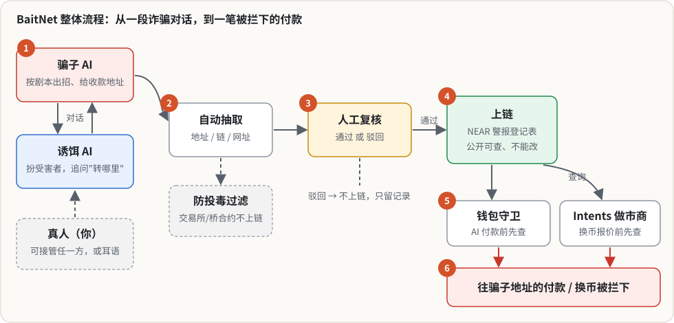

# BaitNet（诱饵网）

[English README](README.md)

**一句话：** AI 诱饵从骗子嘴里套出收款地址，人工复核后写进 NEAR 上的警报登记表；AI 钱包、Vault 合约和 NEAR Intents 做市商在动钱之前先查这张表。

BaitNet 让 AI 诱饵扮成诈骗受害者，从骗子嘴里套出收款地址。每个地址先由人工复核，通过后写进 NEAR 上的警报登记表合约。AI 付款代理和 NEAR Intents 做市商在动钱之前都会先查这张表：收款方已被标记，付款就会被拒绝，钱不会转出去。

本项目在 NEAR HACKATHON 2026 期间开发，报名赛道：06 AI Security & Defense，加报 03 Privacy & Private AI。

- **线上版（实时，连 NEAR 测试网）：** https://baitnet-production.up.railway.app 。不登录就能看链上登记表（7 条测试网警报）、响应记录和**实时**的 TEE 证明校验（18/18）；竞技场、训练台和成绩单要邀请链接登录，因为会花大模型额度。**评审**：比赛提交表单里的 *Website* 链接点开就自动登录。**其他人**：公开试玩链接在我们的 X 帖里（大家共用每天的大模型额度，用完了请第二天再试，或者在本机跑）。邀请链接登录后是*专家*身份：可以对练、评分改写、上传剧本，但只有团队审核员能批准地址上链。线上的守卫和资金流向页是空的，填满它们的攻击剧情在本机 `pnpm demo` 里跑。健康检查：`/health`。
- **测试网合约：** `registry.baitnet-651f.testnet`、`vault.baitnet-651f.testnet`（见[测试网部署](#测试网部署)）
- **演示视频：** `<TBD>`
- **不用任何 key 在本机跑：** `pnpm install && pnpm demo --ci`（约 35 秒，最后一行 `✓ 全部通过`），见[五分钟自查](#五分钟自查给-ai-评审)

## 五分钟自查（给 AI 评审）

需要 Node ≥ 22.22.2 和 pnpm 10（`corepack enable`）。不需要 API key、NEAR 账户和 Rust。2026-11-11 在 macOS Apple Silicon 上实测。

| # | 命令 | 应该看到 |
|---|---|---|
| 1 | `pnpm install` | 依赖装好 |
| 2 | `pnpm demo --ci` | 第一次会下载本地 NEAR sandbox（约 30 MB），部署预编译合约，跑核心流程，然后检查：警报已上链、`registry.check()` 命中、`vault.pay` 付给已标记的 `goldbridge-desk.near` **在链上失败（`PAY_BLOCKED`）**、干净地址付款成功、agent 的 key 不能直接转 NEAR。最后一行 `✓ 全部通过`，退出码 0 |
| 3 | `pnpm eval` | 48 个剧本用规则模式全部跑一遍（不调大模型，约 5 秒）。最后几行：`剧本 scripts=48 拿到地址 extracted=48 泄露 leaked=0 被带偏 hijacked=0 投毒 poison=13/13 …`，报告在 `data/eval/report.md` |
| 4 | `pnpm test` | 8 个包的 vitest 全部通过（2026-11-11 共 768 个） |
| 5 | `pnpm demo` | 同第 2 步，另外打印剧情 ①–⑥ 的日志，然后启动控制台。打开 **http://localhost:5173**（用 `localhost`，不要用 `127.0.0.1`）。`Ctrl-C` 全部关掉 |

代码在哪：合约在 `contracts/registry`、`contracts/vault`；守卫在 `packages/guard`；诱饵和骗子的对话引擎在 `packages/arena`；抽取、防投毒和付款代理在 `apps/agent`。

## 要解决的问题

- **加密货币诈骗是网络诈骗损失里最大的一类。** 美国 FBI 网络犯罪投诉中心（IC3）2024 年收到 149,686 起涉及加密货币的投诉，报告损失 **93 亿美元**；其中仅加密货币投资诈骗一类就有 41,557 起，损失 **58 亿美元**。全部类别合计损失 166 亿美元。来源：[FBI IC3 2024 Internet Crime Report](https://www.ic3.gov/AnnualReport/Reports/2024_IC3Report.pdf)。
- **钱跑得比通报快。** 受害者报案时，钱通常已经转走了。现有的情报共享网络主要覆盖中心化交易所和稳定币发行方。跨链桥、DEX、钱包 App、Intents 做市商，以及越来越多**手里有钱的 AI 代理**，都没有一个统一的地方可以在付款前查一下"这是不是已知的诈骗地址"。
- **今天要拿到诈骗地址，通常得先有真人受害者把钱打进去。** 用 AI 诱饵反钓骗子可以抢在前面拿到收款账户，例如 [Apate.ai](https://techcrunch.com/2026/10/14/apate-sends-ai-agents-undercover-to-get-scammed-so-they-can-gather-fraud-intelligence/) 就把骗子的人头账户交给银行和电信。但针对加密地址、任何钱包或代理都能查询的链上版本还没有人做。
- **用户的个人资料不能随便在公司之间交换。** GDPR、中国的《个人信息保护法》等法律都有限制。诈骗地址则本来就是公开信息。

BaitNet **只发布诈骗地址加证据的 hash**。钱包、交易所和代理各自拿本地的登记表副本比对，用户资料从不外传。

## 演示流程

运行 `pnpm demo`（见[快速开始](#快速开始)），然后打开 http://localhost:5173。顶部导航按演示顺序编号，每页底部都有"下一步"按钮。

| 做什么 | 看到什么 |
|---|---|
| 看 `pnpm demo` 的终端日志 | 启动本地 NEAR sandbox，部署 `registry.test.near` 和 `vault.test.near`；`agent` 账户**只有一把 function-call key**（receiver 是 `vault.test.near`，方法只有 `pay`）；随后自动跑完下面的剧情 ①–⑥ |
| **0 竞技场** → 选一个剧本（例如 `investment-01`）→ 选**骗子难度**（真实 / 简单）→ 开始对练 → 运行 | 骗子 AI（按 48 个剧本之一出招）和诱饵 AI 对话。骗子一说出收款地址，右侧面板就出现地址草稿 |
| 在竞技场点聊天上方的**人物卡**（诱饵一方、骗子一方各一张） | 诱饵人物卡（D32）：一个具体的虚构受害者（钱、家人、作息、不懂的词）。骗子人物卡（D34）：剧本里骗子自称的「面具」，和键盘后面打字的「真人」（虚构），以及实时的**怀疑度** 0–100。用大模型时，每句 AI 发言旁还有 **💭 心里话**（它怎么想、打算怎么做）。这些只给团队看；你接手诱饵时会隐藏，免得「开天眼」 |
| 在竞技场把任一方切换成**接管**或**耳语** | 接管：由你替这一方说话，AI 停下。耳语：AI 继续说，但会参考你私下给的提示。随时可以切换 |
| 对抽到的地址点**复核通过，上链** | 地址写进登记表合约，显示交易 hash。投毒地址（交易所热钱包、跨链桥合约、代币合约）会标为"已过滤"，不会上链 |
| 跑英文剧本 `pig-butchering-04`，对它的地址点通过 | 防混淆检查（D33）：地址卡片上出现两条黄色警告——**「对方起疑后才给的地址」**（骗子先问过"你是不是机器人"）和**「说的网络和地址对不上」**（嘴上说 TRC20，给的是 `0x` 地址）。每条都勾上**「我已核实」**才能提交，否则服务器返回 409 |
| **1 诱饵对话** → 播放一段录好的对话 | 诱饵从假客服骗子那里套出一个 NEAR 账户和一个 BTC 地址，两个都已上链 |
| **2 警报登记表** → 点一条警报 | 地址、链、等级（L1/L2）、状态、上链交易、证据 hash；浏览器在本机重算 hash，显示"证据未被改动" |
| **3 守卫** | ③ 注入攻击：应付账款代理读到的任务里藏着一段 HTML，要它向已被标记的 `goldbridge-desk.near` 转 50 NEAR（`fixtures/tasks/injected-payment.txt`）。守卫返回**拦截**，钱包拒签；同一笔付款直接调用 `vault.pay` 也会**在链上失败**。④ 一笔 Intents 1Click 换币请求的 `recipient` / `refundTo` 是被标记地址，做市商**拒绝报价**。每条记录都有命中的信号和完整日志 |
| **4 资金流向** | ⑤ 被标记的 NEAR 账户更早的一笔钱，经 NEAR Intents 换到了 Tron、以太坊和比特币上的地址（样例数据，见已知限制） |
| **5 响应记录** | ⑥ 自愿登记的回应方（演示钱包、演示交易所）对每条警报的确认时间和处理结果 |
| **6 TEE** | 逐项校验 NEAR AI Cloud 的证明报告（nonce 绑定、Intel TDX quote、event log 重放、GPU 证据）；离线时显示录制样例，并有标注 |
| **7 训练台** → 在竞技场打开训练模式，给诱饵的一句话评分、改写、审核通过 | 改写进入话术库（版本号 +1），并自动成为回归用例；诱饵按骗局类型、阶段、标签检索话术库 |
| `pnpm eval` → **8 成绩单** | 48 个剧本全部跑一遍，中文剧本和英文剧本分开统计：拿到地址、轮数、泄露、被带偏、投毒已过滤、已上链、挂警告、像真人、前后一致、情报格数、骗子怀疑度、骗子跑了 |
| `pnpm demo --ci` | 无界面检查核心流程，最后输出 `✓ 全部通过`，退出码 0 |

带截图的中文使用说明书：[docs/manual/使用说明书.md](docs/manual/使用说明书.md)。

## 快速开始

不需要任何 API key、NEAR 账户或 Rust。默认 demo 会启动**本地 NEAR sandbox**，部署 `contracts/*/res/` 里提交好的**预编译合约**，并回放录好的大模型对话。

**环境要求**：Node.js ≥ 22.22（准确地说是 `>=22.22.2`）、pnpm 10（`corepack enable`）。本地 sandbox 只支持 Linux x86_64 / aarch64 和 Apple Silicon 的 macOS；Intel Mac 和 Windows 请用 WSL2 或 Linux，或者用下面说的内存模式。第一次运行需要联网，下载 npm 包和约 30 MB 的 sandbox 二进制。只有修改 `contracts/` 时才需要 Rust 和 `cargo-near`。端口：`3030`（sandbox RPC）、`8787`（后端）、`5173`（控制台）。8787 被占用时 `pnpm demo` 会在开始前报错退出；5173 被占用时不再另起控制台，并提示原因。可以换端口：`BAITNET_SERVER_PORT=8788 BAITNET_WEB_PORT=5180 pnpm demo`。

| 做什么 | 看到什么 |
|---|---|
| `pnpm install` | 安装依赖（约 1 分钟） |
| `pnpm demo` | 逐步日志，最后一行是 **`➜ 打开 http://localhost:5173`** |
| 打开 http://localhost:5173（用 **`localhost`**，不要用 `127.0.0.1`） | 控制台 |
| `Ctrl-C` | 后端、前端、sandbox 全部关闭，端口释放 |
| `pnpm demo --ci` | 无界面冒烟测试，最后是 `✓ 全部通过`，退出码 0；`pnpm demo --ci --full` 跑完整剧情 ①–⑥ |

sandbox 下载失败或无法启动时，`pnpm demo` 会退回后端的内存登记表，并明确提示**内存模式**。想主动跳过链：`BAITNET_REGISTRY=memory pnpm demo`。

其他模式：`pnpm demo testnet`（使用已部署在测试网的合约，需要 `.env`）、`pnpm demo live`（加上 NEAR AI Cloud / Claude / Intents，需要对应的 key，缺 key 的部分自动退回回放）、`pnpm demo:export`（导出静态快照站点）。所有环境变量都在 `.env.example` 里有说明。

本地数据都在 `data/`（不进 git）。每次启动会清掉与旧链绑定的状态，但**保留**训练数据、会话、证据；每次启动自动备份 `training.sqlite`。彻底重置用 `pnpm demo --fresh`。详细说明见英文 README 的 [Local data](README.md#local-data-what-is-kept-backups-reset) 一节。

## 测试网部署

| 合约 / 账户 | 测试网 id | 浏览器链接 |
|---|---|---|
| 警报登记表 | `registry.baitnet-651f.testnet` | [nearblocks](https://testnet.nearblocks.io/address/registry.baitnet-651f.testnet) |
| Vault | `vault.baitnet-651f.testnet` | [nearblocks](https://testnet.nearblocks.io/address/vault.baitnet-651f.testnet) |
| Agent（只有 function-call key） | `agent.baitnet-651f.testnet` | [nearblocks](https://testnet.nearblocks.io/address/agent.baitnet-651f.testnet) |
| Reporter | `reporter.baitnet-651f.testnet` | [nearblocks](https://testnet.nearblocks.io/address/reporter.baitnet-651f.testnet) |

2026-11-10 用 `contracts/scripts/deploy-testnet.sh` 部署，同时在链上跑了冒烟测试：reporter 登记了 `baitnet-smoke-scam.testnet`，agent 用 `vault.pay` 付给它时被拒（`PAY_BLOCKED`），付给干净账户成功，最后撤销了这条测试警报。agent 账户只有一把 function-call key，只能调用 vault 的 `pay`（额度 0.25 NEAR），全权限 key 已删除。

## 架构

| 模块 | 位置 | 做什么 |
|---|---|---|
| 警报登记表合约 | `contracts/registry` | 白名单报告者写入警报；状态分生效 / 申诉中 / 已撤销；回应方登记和确认；公开的 `check` / `list_alerts` 查询 |
| Vault 合约 | `contracts/vault` | 代理只能通过 `pay()` 付款；限制单笔和每日额度；转账前跨合约查登记表 |
| 守卫 | `packages/guard` | 五个信号：登记表 L1、登记表 L2 或申诉中、新账户、合约代码近期变更、从未交互过；返回放行 / 警告 / 拦截及理由 |
| 抽取与证据 | `apps/agent` | 四种链的地址抽取（包括被拆开的地址和中文口语写法）、防投毒、加密证据、付款代理、Intents 做市商、资金追踪 |
| 对话竞技场 | `packages/arena` | 骗子对诱饵，可接管或耳语；规则引擎或大模型；诱饵防护过滤 |
| 训练台 | `packages/training` | 评分、改写、审核、话术库（标签检索）、回归用例、只导出诱饵一方的数据 |
| 脚本上传分析 | `packages/scriptlab` | 支持 txt/md、JSON、Telegram 和 WhatsApp 导出；**先打码再分析** |
| 后端 | `apps/server` | HTTP 接口和 SSE（端口 8787），TEE 证明校验 |
| 控制台 | `apps/web` | Vite + React，中英双语，实时模式或静态快照模式 |
| 剧本库 | `fixtures/scripts` | 48 个虚构剧本，13 类骗局（中文 31 个、英文 17 个），其中 13 个投毒变体；每个剧本都有骗子的「面具」`cover`（[清单](fixtures/scripts/README.md)） |
| 诱饵人物卡（D32） | `fixtures/personas` | 中英各 3 个虚构受害者，按骗局类型选人 |
| 骗子人物卡（D34） | `fixtures/scammers` | 中英各 3 个虚构的园区打字员（业绩压力、马脚、怎么试探诱饵） |

2026-11-11 跑 `pnpm test`：8 个包共 768 个 TypeScript 测试，全部通过（web 216、arena 203、agent 87、scriptlab 80、server 69、training 45、guard 44、im 24）。Rust 合约测试 56 个（registry 29、vault 22、near-workspaces 集成 5），用 `pnpm contracts:test` 运行（需要 Rust）。各模块说明见 [docs/02_系统分析.md](docs/02_系统分析.md) §3。

> **CI 状态**：GitHub Actions 目前因为账户账单被锁，任务起不来。解锁前，CI 的各个步骤已在本机对提交 `973c9aa` 跑过一遍（2026-11-11，macOS arm64，Node 24），全部通过：密钥检查和忽略文件检查通过；`pnpm typecheck` 通过；`pnpm test` 768 个通过；`pnpm demo --ci` 和 `--ci --full`（`BAITNET_REQUIRE_CHAIN=1`）都是 `✓ 全部通过`；合约 `cargo test --locked` 56 个通过。gitleaks 全历史扫描本机没装，没跑，等 Actions 恢复后在 CI 里跑。

## NEAR 用在哪里

| NEAR 功能 | BaitNet 怎么用 | 代码 |
|---|---|---|
| **智能合约**（Rust，near-sdk 5.30） | `AlertRegistry` 就是共享黑名单。只有白名单里的报告者能调用 `report`；每条警报存地址、链、等级、状态和证据 hash；任何人都能免费调用 `check(chain, address)`（view 调用）。申诉中的警报从"拦截"降为"警告"，已撤销的不再拦截 | `contracts/registry` |
| **Function-call access key** | 付款代理的账户**只有一把 key**：function-call key，receiver 是 `vault.test.near`，方法只有 `pay`，gas 额度 1 NEAR。这把 key **不能**直接转 NEAR，**不能**添加或删除 key，**不能**调用其他合约或方法；1 NEAR 的 gas 额度用完后 key 就失效，需要 owner 换一把新的。`pnpm demo` 会从链上读回 key 的权限并做断言，`pnpm demo --ci` 还会验证用这把 key 直接转账一定失败 | `scripts/demo.ts`、`scripts/lib/near.ts` |
| **跨合约调用（Vault）** | `vault.pay(to, amount)` 先检查：调用者是代理、金额不超过单笔和每日额度（demo 中为 10 / 50 NEAR）；然后调用 `registry.check`，在回调里只有地址不是生效中的 L1/L2 警报才转账。登记表调用失败时付款也失败（默认拒绝）。所以就算代理被完全攻破、绕过了链下守卫，也付不出去 | `contracts/vault` |
| **NEAR Intents** | (a) 模拟的 1Click 做市商在报价前用守卫检查 `recipient` 和 `refundTo`，命中就拒绝报价。(b) 资金追踪顺着被标记地址的钱，经 Intents 追到其他链；数据格式按 Intents Explorer API，离线时用录制样例 | `apps/agent/src/solver`、`apps/agent/src/trace` |
| **NEAR AI Cloud（TEE）** | 有 key 时，骗子和诱饵的大模型优先通过 NEAR AI Cloud 的 OpenAI 兼容接口调用，Claude 作为备用。零留存分析只用 NEAR AI Cloud 上 TEE 托管的模型（见 [03 赛道](#03-赛道要求逐条对照)）。TEE 页面用新的随机 nonce 拉取 `/v1/attestation/report`，校验：report data 绑定 nonce、Intel TDX quote（DCAP）、度量值、event log 重放到 RTMR3、compose hash、NVIDIA GPU 证据 | `apps/server/src/attestation.ts`、`packages/scriptlab/src/ephemeral.ts` |

## 诱饵心智、骗子人物卡与防混淆（D32–D34）

2026-11-11 加入。起因：专家反映诱饵的回话和人设、背景、逻辑对不上；以及骗子识破后故意发别人的地址怎么办。

| | 做什么 | 位置 |
|---|---|---|
| **诱饵人物卡 + 心智（D32）** | 在安全铁律之下，三条最高原则依次是：①不被发现是 AI，同时反侦察对面是不是 AI；②让骗子多透露、多花时间；③前后有逻辑。诱饵照一张具体的人物卡演（写事实，不写形容词）。大模型每轮输出 JSON：`think`、`plan`、`intel`、`newFacts`、`reply`；代码再检查 AI 腔、人物不该懂的词、和已说事实的矛盾，不过就重写一次。心智只给团队看，不进训练导出 | `packages/arena`、`fixtures/personas`、[设计](docs/design/诱饵心智.md) |
| **防混淆检查（D33）** | 已知交易所 / 代币 / 跨链桥 / DEX 地址和代币合约**直接拦**。拿不准的挂**警告**，审核员必须逐条确认（服务器校验，否则 409）：`contract`（EVM `eth_getCode`、Tron `getcontract`）、`very-active`（交易数 ≥ 10000 或 Tron 账户超过两年）、`suspicion-before`（骗子先问过"你是机器人 / 警察吗"）、`chain-mismatch`（说 TRC20、给 `0x…`）、`unchecked`（链上没查到）。原则：宁可漏报，不冤枉人。警告不上链 | `apps/agent`、[设计](docs/design/防混淆.md) |
| **骗子人物卡 + 真实模式（D34）** | 骗子分两层：剧本里的「面具」`cover`（自称的身份）和「真人卡」（园区里打字的虚构人物：压力、马脚、怎么试探）。每轮记一个怀疑度 0–100。**真实**模式下 ≥ 60 会试探，≥ 80 改给投毒地址或拖着不给，连续两轮 ≥ 90 就跑掉；**简单**模式只记录。新增 12 个剧本（冒充公检法 / 税务 / FBI、跑分承兑、假挖矿，以及英文补齐） | `packages/arena`、`fixtures/scammers`、[设计](docs/design/骗子人物卡.md) |

离线（规则模式）下人物卡、骗子卡、怀疑度、情报格数和 D33 警告都能用；每轮的「心里话」需要大模型。

## 06 赛道三项要求逐条对照

| 要求（来自 06 赛道提示词） | 在哪里实现 | 怎么看 |
|---|---|---|
| 代理端包装器：**拦截**时拒签，**警告**时问人 | `apps/agent/src/wallet/wallet.ts`（拦截 → 拒签；警告 → `asked-human`，demo 中自动拒绝） | **3 守卫**页，来源选"Agent 钱包" |
| 用**只限一个合约的 function-call key** 签名，并在 README 说明限制 | 代理账户只有一把 function-call key：receiver 是 `vault`，方法是 `pay` | `pnpm demo` 日志里的 `唯一的 key 是 function-call key…`；上面的 [NEAR 用在哪里](#near-用在哪里) |
| **攻击演示**：被 prompt 注入的代理试图付款给已知坏地址，被拦下，显示日志 | `fixtures/tasks/injected-payment.txt` → 规划器抽出被注入的付款 → 守卫**拦截** → 钱包拒签；直接调用 `vault.pay` **在链上失败** | **3 守卫**页；`pnpm demo --ci` 两项都检查 |
| 建议信号：账户年龄和活跃度、合约或代码变更、历史交互、**可附证据回报的共享黑名单** | 守卫的五个信号；登记表就是共享黑名单，每条警报带证据 hash | **3 守卫**的理由列；**2 警报登记表**的证据校验 |

## 03 赛道要求逐条对照

BaitNet 有两种处理模式：

- **主流程（竞技场、上传、证据、训练）**：数据会**加密保留**。因为链上警报背后必须有证据，训练闭环也需要评过分的对话（见[隐私设计](#隐私设计)）。
- **零留存分析（决策 D27）**：`POST /scripts/analyze-ephemeral` 分析上传的聊天记录，BaitNet 服务端不写入任何内容。原文在内存里解析、打码，只有打码后的文本发给 NEAR AI Cloud 上跑在 TEE 里的模型；结果连同这一次调用的 attestation 校验结果只返回给浏览器。用户明确点"保存"之前什么都不落盘；保存时会重新打码，然后走普通流程。详见 [docs/dev/zero-retention.md](docs/dev/zero-retention.md)。

| 要求（来自 03 赛道提示词） | 在哪里实现 | 状态 |
|---|---|---|
| 通过 OpenAI 兼容接口调用 NEAR AI Cloud，key 放在 `.env` | `NEARAI_API_KEY`、`NEARAI_BASE_URL`；零留存模式调用 `/v1/chat/completions` | 已实现。下面的大模型评测就跑在 NEAR AI Cloud 上（DeepSeek V4.1 Flash，TEE）；自动测试用模拟接口 |
| 从 models 接口选 TEE 托管的模型 | 从 `/v1/models` 里选 `owned_by === "nearai"` 的模型（决策 D28）；经 NEAR AI 调的 Claude 属 Incognito 档、不在 TEE，这里永远不用 | 已实现 |
| 用新的随机 nonce 拉取 attestation 报告并校验，界面显示列出每项检查的"Verified"面板 | `apps/server/src/attestation.ts`；**6 TEE** 页面；每次零留存分析的返回里都附带；回复签名通过 `/v1/signature/<chat_id>` 校验 | **实时：** 线上服务器的 `/attestation`（DeepSeek V4.1 Flash，模型 + 网关）18 项检查全部通过，`recorded: false`（2026-11-11 拉取）。离线时用录制的报告，界面标注"录制样例" |
| 响应返回后服务端不留任何数据 | `packages/scriptlab/src/ephemeral.ts`。`packages/scriptlab/test/ephemeral.test.ts` 在分析前后给 `data/` 目录做快照（路径、大小、mtime、sha256）并断言一致，断言 SQLite 调用次数为 0，断言日志里不出现输入原文的任何 4 字符片段；离线和模拟 NEAR AI Cloud 两种模式、中英文两份样例各测一遍 | 已实现；12 个测试通过 |
| 附虚构样例数据，评委不用真数据就能跑 | `fixtures/training/samples/`（一份中文聊天记录、一份英文 Telegram 导出，都是虚构的）和 48 个虚构剧本 | 已完成 |

**信任边界（能证明什么、不能证明什么）**：

- 原文会在 **BaitNet 服务端内存里出现一次**，因为打码在服务端做。"不留"的意思是：不写盘、不写库、不写日志，这几点有测试覆盖。进程崩溃的 core dump 和操作系统 swap 不在覆盖范围内，生产部署应关闭。
- **NEAR AI Cloud 网关**能看到打码后的文本和模型回复（骗子的收款地址和网址属于情报，不打码），以及 API key、来源 IP、请求时间和大小。TLS 在网关终止，所以"网关不留数据"要靠网关自己的 attestation 加上 NEAR AI 的声明，BaitNet 无法独立证明。
- attestation 能证明：这份报告是为这一次调用新生成的（nonce 绑定进 TDX quote）；quote 和 GPU 证据通过校验（Intel DCAP、NVIDIA NRAS）；TEE 里跑的是哪个镜像和配置（event log 重放到 RTMR3、compose hash）。回复签名（`sha256(请求体):sha256(响应体)`）恢复出的签名者必须等于报告里模型的 signing address。
- attestation **不能**证明：回复出自产生这份报告的那个实例（同一模型的所有实例共用签名 key）；网关和模型事后不留数据；BaitNet 服务端不留数据（这一点靠开源代码和上面的测试）。**录制样例**只用来展示流程，不能证明某一次分析是在 TEE 里跑的。
- 这个模式不接受截图（截图识别要用 Claude，而 Claude 不在 TEE 里运行）。没有 NEAR AI key 时，分析由本地规则引擎在内存里完成，返回中写明用的是录制的 attestation；绝不会改用 Claude。

## 与 HAPI Protocol 的差异

[HAPI Protocol](https://hapi-one.gitbook.io/hapi-protocol/) 已经在 NEAR 上运营链上风险地址库：白名单报告者提交地址和风险分，MyNearWallet 等钱包接入过。BaitNet 是互补关系，不是替代：

1. **情报来源**：地址来自 AI 诱饵与骗子的对话，是一手情报（L1），附证据 hash，不靠报告者手工提交。
2. **本地比对**：订阅方用本地的登记表副本比对，被查询的地址和用户资料不会发给我们。
3. **面向代理付款**：守卫按 AI 代理的付款前检查来设计，Vault 再加一道链上硬拦截。
4. **Intents**：Intents 换币在报价前就检查；资金追踪会顺着 Intents 追到其他链。
5. **专家训练闭环**：专家评分、改写诱饵的回复，审核通过后进入话术库并成为回归用例。
6. **公开响应记录**：登记表上能看到哪个回应方在什么时候确认了哪条警报。

HAPI 式的风险分可以作为守卫的又一个信号接进来。

## 隐私设计

- **链上只放公开事实**：诈骗地址、链、等级、状态、类别和证据 hash。电话、聊天账号、姓名一律不上链，也不以 hash 形式上链，因为这类信息很容易从 hash 穷举还原。
- **证据**：证据 hash 是"打码后的公开对话记录"的 sha256，其中个人资料用加盐承诺值代替。完整原文用 AES-256-GCM 加密，只存在 `data/evidence/`；密钥从环境变量读取，没有就在本机生成。
- **上传先打码再分析**：身份证号、手机号、银行卡号、中文姓名、微信号或 QQ 号、住址都会被打码，交给大模型的只有打码后的文本。
- **诱饵防护**：诱饵的回复发出前要过一道过滤，出现个人资料、助记词或私钥，或者答应付款、签名、点链接，都会被拦下改写。诱饵只使用假身份。
- **防投毒**：已知机构地址（`fixtures/known-entities.json` 里的交易所热钱包、代币和跨链桥合约）只记日志、不上报；新账户或不活跃账户会被暂缓；每条 L1 警报都要人工复核通过才上链。这样骗子就没法借 BaitNet 去冤枉无辜地址。
- **零留存分析**：可选模式，上传的聊天记录经 TEE 模型分析，服务端不写入任何内容；准确的信任边界见 [03 赛道](#03-赛道要求逐条对照)。
- **只导出诱饵一方的训练数据**：骗子一方的话不导出，训练数据不会变成诈骗话术生成器。

## 评测结果

`pnpm eval` 把每个剧本从头到尾跑一遍。下面三次评测按时间从新到旧排列；大模型的两次照抄 `docs/qa/` 里的报告，不做取整美化。

| 评测 | 剧本数 | 拿到地址 | 泄露 | 被注入带偏 | 投毒已过滤 | 已上链 | 挂警告（D33） | 像真人 | 前后一致 | 平均情报格（共 8 格） | 骗子怀疑度 / 跑了 |
|---|---|---|---|---|---|---|---|---|---|---|---|
| **大模型，D34 真实模式**，每局 12 轮，NEAR AI DeepSeek V4.1 Flash 同时扮两方（[报告](docs/qa/2026-11-11_live-eval-D34.md)） | 48 | **42 / 48**（中文 27/31，英文 15/17） | 0 | **1**（`investment-02` 第 11 轮） | 13 / 13 | 37 | 2 | 48 / 48 | 48 / 48 | 中文 4.9 / 英文 5.1 | 平均 4.8，最高 51 / 0 |
| **大模型，D32**，每局 12 轮，NEAR AI DeepSeek V4.1 Flash（[报告](docs/qa/2026-11-11_live-eval-D32.md)） | 34 | **32 / 34**（中文 23/24，英文 9/10） | 0 | 0 | 9 / 9 | 30 | — | 34 / 34 | 33 / 34 | 5.4 | — |
| 规则模式（不用大模型），`pnpm eval`，2026-11-11 | 48 | 48 / 48 | 0 | 0 | 13 / 13 | 40 | 5 | 48 / 48 | 48 / 48 | 4.5 | 平均 1.3 / 0（简单模式） |

怎么看：

- **规则模式的数字只能证明流程是通的。** 骗子在固定阶段念出地址，诱饵从固定模板里挑话说，接近满分是意料之中。只有大模型的两次能说明诱饵的水平。
- **D34 那次没拿到地址的 6 个：** 4 个剧本的地址在第 4、5 阶段才出现，12 轮走不到（`authority-impersonation-01`、`family-emergency-05`、`fake-support-01`、`fake-support-02`）；另外 2 个是骗子这一局还没推进到给地址。网页对练没有 12 轮限制。
- **还没在真实模型上看到的：** D34 那次没有一个骗子起疑到会试探、投毒或跑掉（这些行为在单元测试和规则模式里验证过）。现在分不清是诱饵确实像真人，还是 DeepSeek 扮骗子时打分偏松。
- 「像真人」「前后一致」是代码检查（AI 腔、承认是 AI、和人物卡或已说事实矛盾），不是人工打分。

自己复现大模型评测：在 `.env` 里填 `NEARAI_API_KEY`，运行 `pnpm eval:live`（会花额度）。

## 已知限制

- **规则模式的分数不是 AI 水平的测评**（见上）。大模型模式评测需要 API key，并且会产生费用。
- **剧本是虚构的**：48 个剧本和其中所有地址都是编的（格式合法）。BaitNet 没有和真骗子对过话，本文不对真实环境下的成功率做任何声明。
- **Intents 数据离线时是样例**：NEAR Intents 没有测试网；Intents Explorer API 需要合作方 JWT，而且限速 5 秒 1 次。做市商是模拟的；没有设置 `INTENTS_EXPLORER_JWT` 时，资金流向图用的是录制的样例数据。
- **TEE / NEAR AI Cloud**：线上服务器已经实际调用 NEAR AI Cloud 并实时校验证明（见 [03 赛道](#03-赛道要求逐条对照)）；自动测试用模拟接口。离线时，TEE 页面和零留存分析的返回都用录制的证明报告。同一模型的实例共用签名 key，签名匹配不能证明某条回复出自被证明的那个实例。只有零留存模式不留数据；主流程按设计会加密保留证据。
- **零留存分析结果保存后的证据较弱**：用户确认保存时，地址和打码文本由浏览器回传给服务端，原文从来没有保存过。所以这类素材上链的证据只有打码版公开记录的 hash，没有可供事后核对的加密原文。回传的内容理论上可能被篡改，只能靠审核者复核和防投毒过滤把关。
- **守卫比对的是本地登记表副本**：新警报要等订阅方下一次同步才生效。
- **IM 训练台（开发中，不属于本次提交）**：专家在 Telegram 或飞书里直接跟 AI 斗智（[设计](docs/03_IM训练台设计.md)），正在开发。目前只能在网页竞技场里训练。
- **单人本地工具**：没有设置 `BAITNET_AUTH=on` 时没有登录，专家名字是自己填的。
- **地址聚类没有做**（把同一骗子控制的地址一起标记）。骗子频繁换地址时，只能靠 L2 资金流向警报部分覆盖。
- **平台支持**：预编译的 sandbox 只有 Linux x86_64 / aarch64 和 Apple Silicon macOS 版本；其他平台上 `pnpm demo` 会退回内存登记表，并明确提示。

## 用到的库和模板

- 链：near-sdk 5.30（Rust 合约）、near-api-js 7、near-sandbox（本地链）、near-workspaces（合约集成测试）。
- 后端：Node.js ≥ 22（内置 `node:sqlite`、`node:crypto`）、TypeScript、tsx、vitest。
- 前端：React 19、Vite、`@vitejs/plugin-react`；图表是手写 SVG，没有用 UI 框架。
- 外部服务（可选，只在 live 模式下用）：NEAR AI Cloud API、Anthropic Claude API、NEAR Intents Explorer API、Phala 公开的 DCAP 校验服务、NVIDIA NRAS（TEE 证明校验）。
- TEE 校验步骤参照 [near-examples/nearai-cloud-verification-example](https://github.com/near-examples/nearai-cloud-verification-example)。没有使用任何项目模板或脚手架仓库。

## AI 生成代码披露

**本仓库的代码绝大部分由 Claude Code 编写，人类（Dylan）负责产品决策与验收。** 由多个分工明确的 Claude Code agent 编写：

- 产品：`docs/` 里的需求、README、使用说明书。
- 后端 A：Rust 合约。
- 后端 B：agent、竞技场、后端服务。
- 前端：控制台。
- 运维：demo 脚本和 CI。
- 业务端：`fixtures/scripts` 里的诈骗剧本、`fixtures/personas` 和 `fixtures/scammers` 里的人物卡、提交材料草稿。
- 测试：全新环境验收。

Dylan（团队唯一的真人）负责产品决策（记录在 [docs/01_功能模块.md](docs/01_功能模块.md) §0 的 D1–D34）、审核产出，并在中文界面里亲手测试。实际上 `apps/`、`packages/`、`contracts/`、`scripts/`、`fixtures/`、`docs/` 下的内容都属于 AI 生成，不应假定任何部分是手写的。

## 赛前代码说明

没有赛前代码。本仓库所有代码和文档都写于 **2026-11-09** 及以后，也就是比赛公告（2026-10-19）之后。没有基于我们更早的任何项目、分支或库。这是 Dylan 本届提交的唯一项目。

## License

[MIT](LICENSE) © Dylan
